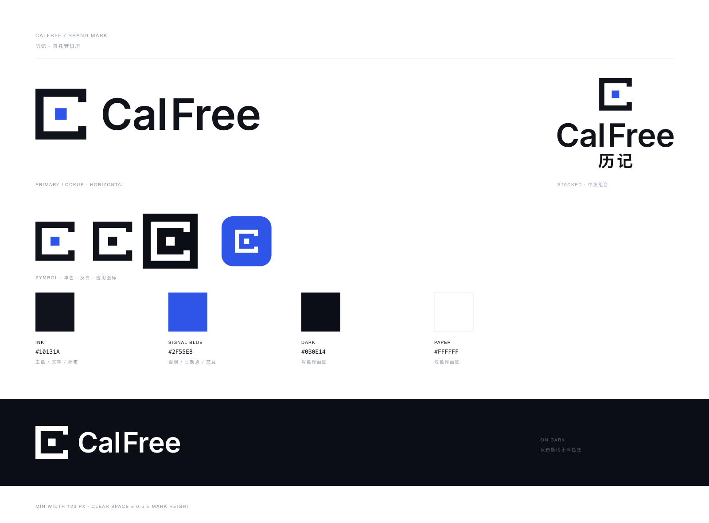

# CalFree / 历记 · 品牌标志

极简几何标志，为自托管 CalDAV 日历服务设计。



## 概念

**标记 = 开口的方框 + 一枚日期块。**

方框是日历的骨架，右边留出缺口 —— 框不再是封闭的，日历被"打开"了，对应 CalFree 的 *Free*：数据自由、可自托管、不被平台锁住。缺口里那枚方块是一天、一条记录，也是 **历记** 里的"记"。

标记同时是一个方形的 **C**，与字标首字母呼应，但用直角轮廓和圆润的 Inter 字标拉开层次，不会读成重复的字母。

- 方框 / 缺口 / 日期点全部为纯几何构造，无描边、无渐变、无细节损失。
- 单色、反白、32px 小尺寸均保持可辨识（小尺寸另有光学修正笔画）。

## 颜色

| 名称 | 值 | 用途 |
| --- | --- | --- |
| Ink | `#10131A` | 主标志、文字 |
| Signal Blue | `#2F55E8` | 日期点、强调、应用图标底色 |
| Dark | `#0B0E14` | 深色界面底 |
| Paper | `#FFFFFF` | 浅色界面底 |

Signal Blue 与现有 `web/public/icon.svg` 的蓝色一致，替换时不会打断界面观感。

## 文件

```
brand/
├── svg/
│   ├── logo-horizontal.svg          主组合（横版）
│   ├── logo-horizontal-inverse.svg  横版 · 反白
│   ├── logo-horizontal-mono.svg     横版 · 单色（日期点同为主色）
│   ├── logo-stacked.svg             中英竖版组合
│   ├── logo-stacked-inverse.svg     竖版 · 反白
│   ├── logo-mark.svg                标记（含蓝色日期点）
│   ├── logo-mark-mono.svg           标记 · 单色
│   ├── logo-mark-inverse.svg        标记 · 反白
│   ├── logo-wordmark.svg            纯字标
│   ├── app-icon.svg                 512 应用图标（圆角蓝底）
│   └── favicon.svg                  32 图标（笔画加粗的光学修正版）
├── png/                             各版本 3× 预览与固定尺寸导出
├── src/
│   ├── build_logo.py                生成器（SVG + PNG）
│   ├── make_sheet.py                生成品牌预览图
│   └── inter-bold-outlines.svg      字标源轮廓（Inter Bold）
└── logo.vectorcraft                 可编辑矢量工程（VectorCraft 原生）
```

所有 SVG 都已**轮廓化**，不依赖任何字体文件，放到任意环境渲染结果一致。

## 使用规范

- **最小尺寸**：横版整组 `≥ 120px` 宽；标记单独使用 `≥ 24px`。更小请使用 `favicon.svg`。
- **安全空间**：四周留白 ≥ 标记高度的 `0.5×`。
- **不要**：拉伸变形、改变标记与字标的相对大小、给标记加描边或投影、把日期点换成其他图形。
- **单色场景**（传真、烫金、单色印刷）用 `-mono` 版本；深色背景用 `-inverse`。

## 重新生成

```bash
cd brand/src
python3 build_logo.py      # 需要 fontTools、rsvg-convert
python3 make_sheet.py
```

`build_logo.py` 里集中了全部可调参数：标记笔画 `frame_open(t_frac)`、开口比例 `open_frac`、字标字号 `cap`、字距表 `KERN`、拼版间距 `gap`。

## 字体说明

- **字标 CalFree**：Inter Bold，已转曲。Inter 采用 SIL Open Font License 1.1，可自由用于标志与再分发。
- **中文历记**：Hiragino Sans GB W6（macOS 系统字体），已转曲。若用于正式商用发布，建议替换为自有授权的字体（如思源黑体 / Noto Sans SC，同为 OFL），再重新生成一次即可 —— 只需改 `cjk()` 里的字体路径与字重。

## 平台图标

`src/apply_icons.py` 会把标记分发到所有平台，换标志时只需重跑一次：

```bash
cd brand/src && python3 apply_icons.py        # 加 --dry-run 只看清单
```

| 平台 | 位置 | 规格 |
| --- | --- | --- |
| Web / PWA | `web/public/icon.svg`、`icon-192/512.png` | 圆角 22.5%，透明角 |
| PWA maskable | `web/public/icon-maskable-192/512.png` | 满版，标记 44% 落在安全区 |
| Apple touch | `web/public/icon-180.png` | 满版不透明（iOS 自己加圆角） |
| Android | `mipmap-*/ic_launcher.png` | 48 / 72 / 96 / 144 / 192 |
| Android 自适应 | `mipmap-anydpi-v26/ic_launcher.xml` + `drawable/ic_launcher_foreground.xml` | 108dp 矢量前景 + 品牌蓝底色 + monochrome |
| iOS | `AppIcon.appiconset/*` | 19 档，满版、无 alpha |
| macOS | `AppIcon.appiconset/app_icon_*` | 16–1024，圆角留白 |
| Windows | `runner/resources/app_icon.ico` | 16/24/32/48/64/128/256，≤32 用加粗笔画 |

`internal/web/dist/` 是前端构建产物，脚本会同步写入一份，保持与 `web/public/` 完全一致。

## 尚未执行

- 本机没有 Java / Xcode 环境，Android、iOS、macOS 的图标资源已按规范写好但**未实际编译验证**；首次构建时请留意 Android 自适应图标与 iOS 图标集是否被正确识别。
- 未做商标近似检索，正式注册前请自行核查。
